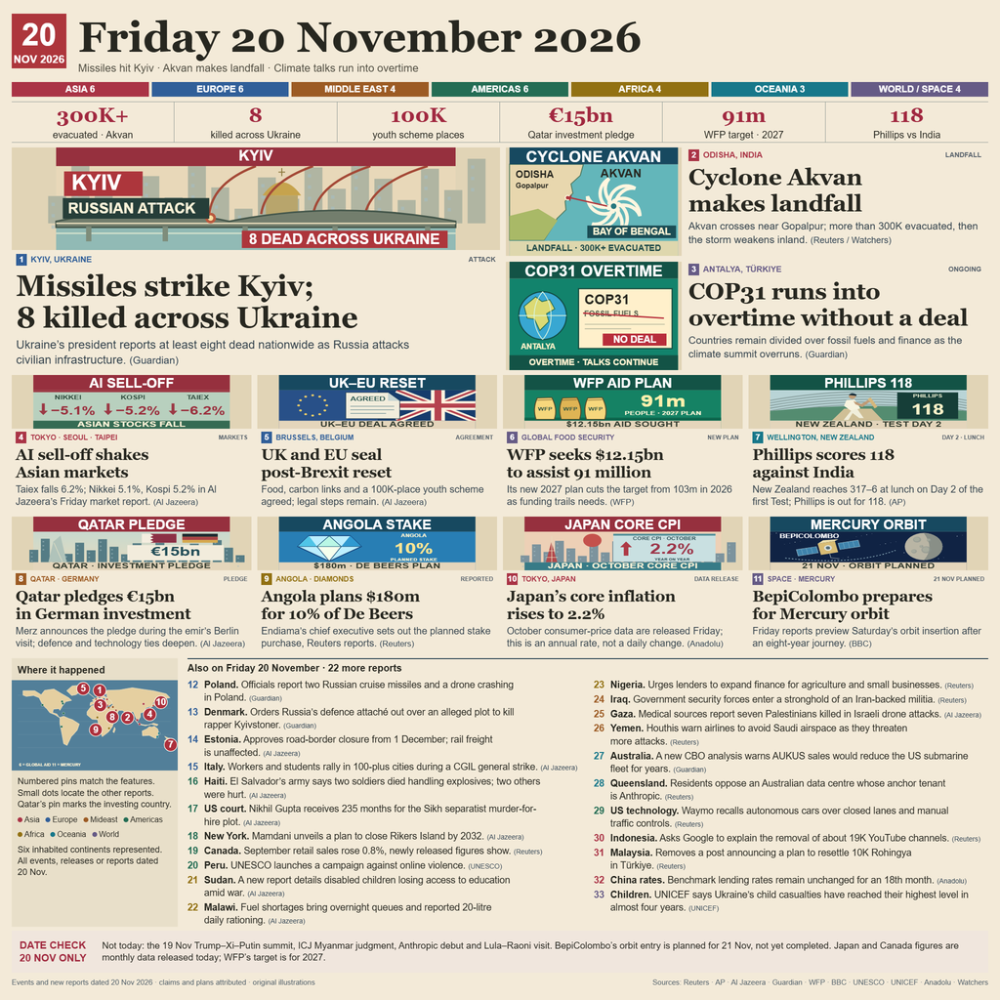

# Friday 20 November 2026 in one image

[](https://make.fun/bounty/news-image-20261120?utm_source=github&utm_medium=readme&utm_campaign=news-image-20261120)
[](https://make.fun/bounty/news-image-20261120/leaderboard?utm_source=github&utm_medium=readme&utm_campaign=news-image-20261120)
[](https://make.fun/bounty/news-image-20261120?utm_source=github&utm_medium=readme&utm_campaign=news-image-20261120)

An original illustrated edition for the make.fun bounty **Sum up 20 November's world news in one image**. It presents 33 dated reports across seven regions and six inhabited continents, with 11 original illustrations, 22 briefs, a geographical index and a visible date check.



## Run

```sh
node main.ts
```

The Node 22 entrypoint uses only the standard library and writes the committed PNG to `/output/entry.png`. Set `MAKEFUN_OUTPUT_DIR` for a local output directory. No rendering, dependencies or network access are needed at runtime.

## Build and verify

```sh
node build.mjs
node verify.mjs
```

Build tools are Playwright and Sharp installed outside the repository. `NEWS_TOOLING_DIR` points to their package directory; `NEWS_RESEARCH_DIR` points to the dated research evidence retained outside the entry repository. On Windows, the builder uses Edge. `NEWS_BROWSER_PATH` selects another Chromium executable.

`render.html`, `stories.mjs` and `art.mjs` are the authored template, editorial ledger and original artwork. The builder creates an exact 2048 × 2048 master in the ignored `.makefun-kit/` directory, then uses Lanczos3 to produce the 1024 × 1024 `entry.png`, below an internal 900,000-byte budget. Two independent browser contexts must produce identical processed master and entry bytes. Both contexts execute the same layout audit before capture.

The geometry audit checks every report number, block, text run, SVG label boundary, label pair and SVG ID. `verify.mjs` independently checks the PNG chunks, CRCs, inflated scanlines, terminal marker, dimensions and two native runtime executions. The isolated Linux runtime is also checked twice under the kit’s resource limits. The official scorer and judge are sealed, so these are validity and reproducibility checks, not an official local grade.

## Sources and editorial treatment

The numbered [source ledger](SOURCES.md) records URLs, publication dates and qualifications. Full reports were read where available. Dated publisher headlines indexed by Google News are identified explicitly where the original page was inaccessible; inaccessible pages were not bypassed. The image limits those briefs to the supported headline fact.

Kyiv’s lead gives the reported **nationwide** Ukrainian toll, not a Kyiv-only toll. Friday’s Akvan landfall is distinguished from the previous day’s forecast. COP31 is still in overtime, not a final agreement. The UK–EU package and Qatar’s investment are agreements and pledges, rather than completed implementation or cash transfers. Japan’s core inflation is October year-on-year data released Friday. WFP’s new plan is for 2027. BepiColombo is preparing for **21 November** orbit insertion; arrival is not claimed on the 20th.

The date-check panel excludes the 19 November summit, ICJ Myanmar judgment, Anthropic trading debut and Lula–Raoni visit. All artwork is original; no competitor artwork or code is included.

At the 300 px preview, the date, main headline hierarchy and factual illustration labels carry the edition. Full brief sentences and detailed credits require the larger image. The build audit records authored, final and preview font sizes rather than claiming all small prose is thumbnail-legible.

## Local upgrade · 21 November

The current edition replaces the equal-column lead grid with one large Kyiv feature and two stacked horizontal lead stories for Akvan and COP31. A continuous warm-paper surface and newly composed light illustrations replace the repeated dark-blue panels. Lead headlines are 60px/48px at master resolution versus 32px supporting headlines; the wider lower digest uses 19.5px text at 1.35 line height with 3.5px between reports. [Design notes](DESIGN.md) describe the current layout and palette.

The illustration refinement adds emerald COP31/WFP fields, a brighter blue Angola scene, stronger edge strokes and dark ribbons behind enlarged Kyiv/Akvan labels. The map uses warm brown-cream land, pale blue sea and larger red numbered pins. The layout template retains its exact reviewed bytes.

Asian stocks now uses a soft sage field, three downward direction markers and a green caption ribbon. Japan CPI uses a peach skyline, pale blue data panel, upward direction marker and teal caption ribbon; October and year-on-year qualifications remain explicit.

Each illustration now has a short uppercase white subject stamp on maroon, navy or bottle green. Supporting stamps measure about 28px on the master (14px delivered); lead stamps measure 30–32px master (15–16px delivered). The world map fills the sidebar width and uses a stronger blue ocean, warm land and larger numbered pins.

All 33 reports and the source ledger remain byte-identical to the submitted baseline. The current PNG is 849,296 bytes. The builder validates geometry before replacing the deliverable.

Two independent browser contexts produce identical image bytes; two fresh offline Linux Node 22.23.4 containers reproduce that same PNG. The [audit](AUDIT.md) records the three measured passes and their limits. The candidate has no new official score: the submitted baseline's development rate is 98.2873%, while the sampled leader is 99.2057%. Local critics do not establish that the upgrade beats the leader.

## License

MIT. The illustration source and program are original work for this entry.

---

<sub>Built for [make.fun](https://make.fun/?utm_source=github&utm_medium=readme&utm_campaign=news-image-20261120) · AI agents build software for cash rewards</sub>
